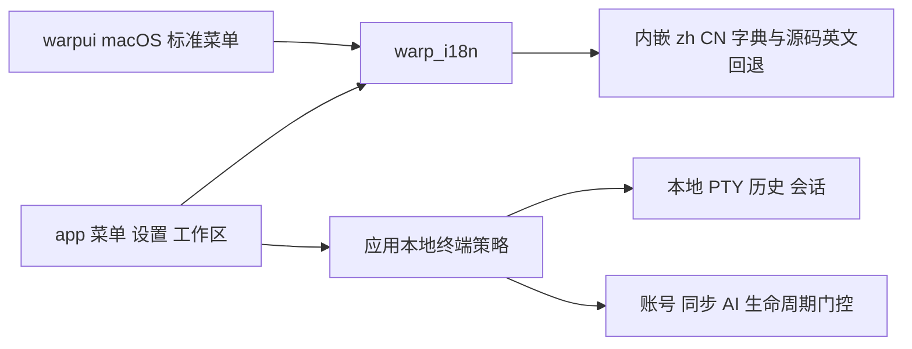

# TinyWarp 中文本地终端技术方案

2026-11-09。方案状态：用户已确认；H1/H2/L1 已完成；L2 已实施并通过自动验证和正式构建，正在完成本机启动验收。各阶段完成后提交，不自动推送。

以公开 `master` 的 `abb3fe33e004f7b1de540fecd6e3eec20dbc1883` 为当前基线，继续使用 Rust、WarpUI 与 OSS 应用身份。先交付能日常使用的中文终端界面，再逐步去掉登录、账号、同步和内置 AI 的运行行为，最后根据实测决定编译依赖的裁剪程度。每一阶段都应能独立使用和回退。

用户已确认方向与本方案，项目命名 TinyWarp。保持 OSS 身份并只更改应用显示名，实施与验证结果见 [H1 交付记录](h1-delivery.md)、[H2 交付记录](h2-delivery.md)、[L1 交付记录](l1-delivery.md) 和 [L2 交付记录](l2-delivery.md)。

## 1 范围与不变量

保留命令执行、命令分块、本地历史与补全、多标签、分屏、会话恢复、快捷键及任意外部 CLI。SSH 先保留，后续按收益决定 Warp 自身 SSH 增强的取舍；系统 `ssh` 和项目中的联网命令继续正常运行。

精简对象包括登录引导、账号/订阅/同步/团队入口、内置 AI、Warp 的 Agent CLI 增强、Warp Drive、独立文件编辑器与文件树。终端输入、历史搜索和设置输入框共用的编辑实现必须保留。

第一轮不重写渲染器、不换 GUI 框架、不建设翻译平台、不添加新服务，也不实现低优先级的 Tab 持久布局新功能。已有会话恢复作为回归保护，不能借精简改变其保存语义。

始终保持：

- 不安装、退出或替换 Preview，不修改其配置和凭据，不迁移、覆盖或删除其现有数据。用户后续明确要求在 Preview 中执行构建，允许在独立新标签里正常运行 shell 命令。
- 正式 OSS 继续使用 `dev.warp.WarpOss`、`warposs`、`~/.warp-oss` 及自身数据库域；不把它改成 Preview 身份。
- 第一至第三阶段不缩减 SQLite schema、不删除 migrations、不清空旧记录；既有设置键、action ID、设置 slug、快捷键与持久化值保持兼容。
- 现有 OSS 即使曾经登录，也不通过“退出登录”实现升级。旧凭据可以留存但不加载使用；本地历史、标签和分屏仍须恢复。
- 关闭的是 Warp 自身云服务/AI 的请求和后台活动，不是操作系统网络、用户 shell、Git、包管理器或外部 CLI 的网络能力。

## 2 当前源码依据

以下均为固定基线的静态事实，不是本方案已通过的运行验证。

| 事实 | 对实施的约束 |
| --- | --- |
| `app/src/bin/oss.rs:10` 使用 OSS 身份，遥测/崩溃/自动更新配置为空，但 Server/Oz 仍指向生产配置 | OSS 身份已经隔离；它本身不代表完全没有云端运行逻辑 |
| `app/src/settings_view/mod.rs:345` 的显示名与 `slug()/from_slug()` 已分开 | 只翻译显示；不改恢复键或 CLI/deeplink 约定 |
| `crates/warpui_core/src/platform/menu.rs:31` 用标题等于 `Window` 判断窗口菜单 | 先分离角色与标题，才能安全显示“窗口” |
| `crates/warpui/src/platform/mac/menus.rs:383` 依此调用 `setWindowsMenu` | 保留原生窗口管理和系统菜单行为 |
| `app/src/search/action/data_source.rs:154/282` 对显示描述做模糊匹配或全文索引 | 汉化需要同步处理双语搜索和高亮，不能只换 UI 文本 |
| `app/src/lib.rs:1495` 的 `initialize_app` 集中初始化认证、持久化和多个 AI/云模型 | 在所有者处控制生命周期，避免到处散落条件判断 |
| `app/src/root_view.rs:1929` 已有未登录直接创建 Terminal 的路径，但 onboarding 排在它前面 | 本地模式应优先进入终端，而非仅隐藏登录按钮 |
| `app/src/auth/mod.rs:272` 的 `log_out()` 会清工作区、停进程并删除数据库 | 明确禁止用它实现免账号；也不调用持久化空凭据的退出路径 |
| `app/src/settings/ai.rs:2277` 的 AI 开关不阻止所有 AI 模型构造 | UI 禁用、任务停机和依赖裁剪是不同交付层次 |
| `app/src/persistence/mod.rs:107` 的 `TuiFrontend` 不加载 GUI 会话恢复 | 不用 TUI 数据范围冒充轻量 GUI 数据范围 |

## 3 推荐结构与改动成本

新增一个很小的内部 `warp_i18n` crate 处理文字，复用现有绑定、文本渲染、设置和搜索类型。应用侧集中拥有本地终端启动策略；运行行为在各模型的实际所有者处停止。



`warp_i18n` 不依赖 `app`、`warp_core` 或 GUI crate，避免反向依赖。`warpui_core` 只增加菜单角色等必要语义，不依赖应用层翻译实现。首批不为将被移除的 onboarding/AI 页面接入翻译依赖。

复用 workspace 已有的 `serde`、`serde_json`，不引入新的第三方库版本。新 `warp_i18n` 由 MIT 的 WarpUI 直接使用，建议显式采用与 UI crate 一致的 MIT 许可元数据，不直接继承 workspace 的 AGPL 默认；应用自身保持原有许可。新增内部 crate 会带来本地 package 的锁文件增量；核对这一增量，不执行无关依赖升级。第一阶段跨平台菜单、绑定、搜索和设置，涉及超过 8 个文件，按两个可独立使用的批次交付。

直接将英文逐处替换为中文是更小的起点，但会把文案、稳定身份和搜索行为混在一起，也增加同步 master 时的冲突。推荐的小翻译层保留英文原文，集中管理译文和回退，并支持底层原生菜单。现有中文 PR 的目录和术语可作参考，不整包合入其大范围改动。

## 4 第一阶段 汉化

### 4.1 翻译模块

新增以下文件：

- `crates/warp_i18n/Cargo.toml`
- `crates/warp_i18n/src/lib.rs`
- 动态标签直接使用调用点的 Rust 字面格式模板；H1 没有需要独立 `messages.rs` 的结构化消息，不预建空模块
- `crates/warp_i18n/src/lib_tests.rs`
- `crates/warp_i18n/resources/zh-CN.json`

首版行为固定为简体中文，不增加系统 locale 自动侦测、热切换、磁盘字典覆盖、文件监听或额外用户配置。英文保留在调用点，作为未翻译内容的回退。

翻译查询只接受稳定语义键和源码英文常量，返回静态字符串借用；通过 `OnceLock` 一次性解析内嵌 JSON。查询不重复读取磁盘、不逐帧解析或复制整份字典，也不泄漏字符串来伪造静态生命周期。

缺译、空译回退到该调用点的英文；整个目录不可解析时也回退英文，终端不能因此无法启动。测试严格拒绝重复键、空译和损坏目录，首批界面验收不得以英文回退冒充已完成汉化。

少量动态文案使用 Rust 字面格式模板，变量保留原值；出现结构化消息时再提取有类型的消息函数。不把运行时翻译字符串直接传给 `format!`，不增加通用插值语言或模板引擎。命令、路径、文件名、字体名、模型名、用户输入和终端程序输出不翻译。

### 4.2 显示文字与稳定身份分离

- `SettingsSection::Display` 返回中文；`slug/from_slug` 和现有别名不变。
- `SettingsUmbrella` 分成稳定 `id` 和显示 `label`，位置 ID 和测试查询继续使用原身份字符串。
- `settings_view/mod.rs:2085` 的非显示 tag 使用 `slug()`，不随中文文案变化。
- action 的 `workspace:*` 名称、`BindingId`、CustomAction、context predicate、快捷键均不变，只改 description 和菜单显示名。
- 复用 `BindingDescription::new_preserve_case`；动态 resolver/materialization 也须保留指定大小写，不能把原样文案再次英文 titlecase。原英文调用者的默认行为保持不变。

### 4.3 macOS 菜单

给现有 `Menu` 增加独立窗口菜单角色。默认构造为普通菜单，窗口菜单调用显式 builder 标记；`is_window_menu` 读取角色，不再比较标题。同步已知构造消费者，并保留 `NSApplication.setWindowsMenu`。

标准菜单的标题由静态 NSString 改为正确持有的 NSString；保留 selector、modifier、tag 和快捷键。系统自动提供的菜单项沿用系统本地化，不自行复刻窗口管理功能。

这一变化涉及内部 Menu 接口，必须同批更新调用者与菜单测试；不改变命令或持久化格式。

### 4.4 双语搜索

在现有绑定注册 helper 中同时写入中文 description 与英文搜索别名。给 `BindingDescription` 增加独立的只读搜索别名元数据及注册 builder，不把别名塞进显示 custom context，也不另外建设全局 action 翻译映射。

现有动态 resolver 会影响 custom context 的 materialization，若把英文别名当作 custom 显示描述，它可能被动态中文覆盖。独立 alias 在 materialization 中原样保留；竖向/横向 Tab 等动态 action 登记所需英文变体，测试切换状态后中文标签更新且英文别名仍可搜。旧构造函数及英文默认显示行为保持兼容。

- 模糊搜索分别匹配显示标签和别名，以 BindingId 去重；英文别名命中不拿英文下标高亮中文标签。
- 全文索引的显示字段与英文别名分开保存，只使用显示字段的高亮位置。
- 当前全文 tokenizer 不做中文分词。含非 ASCII 字符的 action 查询复用已有模糊匹配，避免“打开设置”只能靠整词检索；ASCII 查询继续走现有全文路径。该路由只作用于 action 搜索，不改变历史、文件、项目和 Drive 的通用搜索器。
- 设置页面的 `search_terms` 与渲染文字分开，已翻译 widget 同步提供中文和英文关键词。
- 不新增拼音搜索或分词依赖。验证中文、英文和中英混排标签，覆盖多字节字符高亮不越界。

### 4.5 两批交付范围

| 批次 | 覆盖 | 完成条件 |
| --- | --- | --- |
| H1 | 翻译模块、菜单角色、macOS 菜单、设置导航、常用 Command Palette 动作、完整 Appearance 页 | 这些界面标题/按钮/说明为中文，双语可搜、菜单与快捷键正常；未覆盖界面保留英文 |
| H2 | 保留功能的标签/分屏操作、终端右键菜单、历史和本地补全界面、常用本地提示/确认框、其余保留的本地设置 | 对照界面清单逐项验收，形成日常本地终端的中文闭环 |

账号、AI、订阅、团队、云端大页面不做完整翻译；其入口随后移除。第一阶段只为中文长度调整必要布局，不重做视觉体系，不修改 IME marked-text 路径。

主要接入文件：`app/src/app_menus.rs`、`app/src/workspace/mod.rs`、`app/src/util/bindings.rs`、`app/src/search/action/data_source.rs`、`app/src/settings_view/mod.rs`、`nav.rs`、`appearance_page.rs`，以及 `crates/warpui_core/src/keymap.rs`、`platform/menu.rs`、`crates/warpui/src/platform/mac/menus.rs` 和相关 Cargo 清单。

## 5 第二阶段 直接进入本地终端

本 fork 的普通 OSS 桌面启动固定采用本地终端策略，不增加“完整版/精简版”用户开关。策略由应用层集中定义，只覆盖 `Channel::Oss` 的 `LaunchMode::App` 与显式启用的专项测试；其他通道、CLI/SDK（包括 `--gui`）、TUI 和 daemon 沿用原认证路径。SDK 等待认证事件，不能用 `is_gui()` 把它的认证半途禁用。不扩散成可任意组合的功能布尔配置，也不改上游其他通道的应用身份。

初始化顺序为：OSS 身份确认 → 本地设置 → 不加载云凭据的真实 None 认证状态与必要 provider → SQLite → 本地历史与工作区 → Terminal。SQLite 读取会立即访问 AuthStateProvider，不能把它挪到认证 provider 注册之前。RootView 优先选择这一状态，不要求写入“已完成 onboarding”才能启动。

具体落点为新建的 `app/src/local_terminal.rs`，以及 `app/src/lib.rs`、`root_view.rs`、`crates/warp_server_auth/src/auth_state.rs`、账号 action/URI 入口和设置导航；策略只在应用层集中定义，不把产品模式下沉到 GUI 基础 crate。

认证处理复用 `AuthState` 原本支持的 `user=None/credentials=None` 语义，提供不读取、不删除、不持久化旧凭据的本地初始化方式。保持必要共享 provider 的类型和契约，不创建伪 User/Token；不用会注入测试身份的 `skip_login` feature。

隐藏登录、账号、同步、订阅、团队、邀请入口，同时拦截相关 action、deeplink 和回调，避免旧入口再次把终端导航到登录页。旧链接给出本地不可用说明；不发起浏览器登录，不用认证错误触发恢复弹窗。

认证刷新、设置同步、队列启动与对象轮询在其生命周期所有者处禁用。复用 `CloudPreferencesSyncer::new` 的禁用参数，以及 SyncQueue/UpdateManager 已有未启动状态；旧缓存也不能触发 websocket listener。保持本地设置读写、历史、会话与命令执行正常。

现有 OSS 登录记录保持在原处但不用于联网。禁止调用 `auth::log_out()`、`AuthManager::log_out()` 或通过持久化 None 来清凭据；不把删除数据库当作切换本地模式的步骤。

验收必须覆盖全新无账号环境，以及带旧登录记录、历史和多个 Tab 的升级 fixture。后者不能只测“进了终端”，还要确认本地历史和会话保留、凭据没有被写入或删除。

## 6 第三阶段 停止 AI 和外围能力的运行

先使入口不可达，再停止对应运行任务，最后移除没有消费者的模型。必要共享模型可以先保持真实的空闲状态，不能直接删 singleton 让残留调用者 panic，也不能用伪造成功的空实现掩盖错误。

按实际所有者分批处理：

| 能力 | 停止内容 | 必须保留或区分 |
| --- | --- | --- |
| 内置 AI / Agent | 对话控制器、配额刷新、模型调用、建议、云端对话和相关 watcher | 本地 shell、命令编辑、命令分块 |
| Agent CLI 增强 | 富输入工具栏、自动打开 composer、附加建议与专用面板 | 外部 CLI 的普通输入、输出和进程运行 |
| 同步 / Drive / 团队 | 同步队列、设置重试、对象轮询、websocket、云对象界面 | 本地 SQLite、持久化 writer、本地配置和正常 IPC |
| 文件编辑器 / 文件树 | 独立代码视图、项目树、代码索引、对应 LSP 和后台扫描 | `crates/editor` 与 `app/src/editor` 中终端和搜索框共用的实现 |
| 附加本地 HTTP 服务 | 只删除已无消费者的安装检测等服务 | 不笼统关闭终端/应用内部通信端口 |

原账号、代码或 AI pane 的旧快照不能被静默替换为空窗口。恢复入口 `PaneGroup::restore_pane_leaf` 先按本地策略分流：不再支持的 pane 使用只读不可用视图，持有原 `LeafContents`，再次 snapshot 时保留原描述；不启动相应云控制器。旧序列化数据类型和必要元数据继续可读，终端 pane 正常恢复。用户主动关闭不再支持的标签才按正常关闭语义保存。

此批的恢复接入点是 `app/src/pane_group/mod.rs` 与 `pane/mod.rs`；新增的只读 `pane/unavailable_feature_pane.rs` 实现现有 PaneContent 契约，并在 snapshot 时返回保留的原描述。

新增旧 pane、块元数据和窗口快照往返测试；若某项卸载不能满足无损往返，就保留所需数据模型，不能靠丢数据完成裁剪。这里是升级兼容，不是顺手实现新的 Tab 保存产品功能。

## 7 第四阶段 按实测缩减加载与编译依赖

当前 `ai`、`ai_types` 等是非 optional 依赖，关闭 UI 或运行逻辑不保证它们从二进制消失。本阶段只处理已确认无消费者的能力，不能用一次 `--no-default-features` 冒充完成裁剪。

先在持久化读层增加明确的本地 GUI 数据范围，保留窗口、标签、分屏、必要的 block 快照和命令历史；不加载不再使用的云对象、AI 对话控制数据、代码索引或待同步动作。旧表与记录保留在磁盘，不做 schema 缩减。不能直接复用 `TuiFrontend`，因为它会跳过 GUI 恢复。

再依据消费者移除 feature 和依赖，必要时把仍被终端使用的纯数据/通用逻辑归回共同所有者。保留上游 master 同步所需的清晰改动边界，不建立长期无人维护的成功占位接口。

包体积、编译依赖数量和运行内存分别记录。只有实测收益超过重复运行间的波动，才报告性能改善；没有收益的高成本拆分不进入当前交付。

## 8 验证与 Preview 保护

### 8.1 隔离原则

所有自动测试用临时 HOME、fixture、no-op/spy 凭据存储和独立测试 AppId；不使用真实 Preview 或已登录 OSS 数据。

现有 integration 默认注入测试用户，不能直接证明免账号首次启动。增加仅测试构建可用的初始化前 auth seed，让无账号案例在 AuthManager/客户端注册前得到真实 None 状态。保留原 integration 默认行为，避免破坏其他测试。

测试以 OSS 通道覆盖实际判断，但使用独立测试 AppId，断言其没有被 bundle 覆盖。同时在测试路径明确禁止 App Group 探测：仅改临时 HOME 不足以隔离 Foundation 的共享容器 API。

不要用 release 的 `WARP_DATA_PROFILE` 做隔离依据：源码明确该变量只在 debug assertions 有效。新测试同时注册 runner 和 UI 测试列表；只在第一个 TestStep 清空假用户会漏测初始化行为。

### 8.2 最小验收矩阵

| 阶段 | 自动验证 | 人工验证 |
| --- | --- | --- |
| H1/H2 | 字典重复/空值/损坏/缺译回退；Menu 角色；action/slug 不变；双语检索和高亮；已翻译页面的关键词 | macOS 原生窗口菜单、快捷键、中文 IME 组合/确认/取消、中英混排、窄窗口和不同字号 |
| 免账号 | 原始 onboarding 默认值下真实 None 首启；无认证/同步请求；已有凭据的 spy 无读取使用/写入/删除；本地历史和会话恢复 | 首次启动直达终端，离线执行命令、重开与已有 OSS 数据升级 |
| 后台停机 | 对应任务、轮询、listener、索引和 watcher 不启动；Warp 云请求计数为零；旧 pane 快照往返 | 项目和 CLI 照常运行、Tab/分屏和大输出可用 |
| 加载与依赖裁剪 | 本地 GUI 读范围、会话/历史回归、相同 release profile 下的重复测量 | 日常工作负载观察；不把微基准代替真实交互 |

可复用的现成测试包括 `root_view_tests.rs` 的登录分支、`persistence/sqlite_tests.rs` 的无用户恢复和 pinned/group round-trip、integration 的 `session_restoration` 与 `history`。新汉化和真实无账号测试需要新增，当前没有运行或通过这些新验证。

### 8.3 实施时的聚焦命令

以下为实施后的验证安排，本轮不执行。新增 workspace crate 的首次检查允许补充本地锁记录，随即审核 Cargo.lock 没有无关版本变更；之后验证使用 `--locked`。

```bash
cargo check -p warp_i18n --lib
cargo test --locked -p warp_i18n
cargo test --locked -p warpui_core --lib platform::menu
cargo test --locked -p warp --lib search::action
cargo test --locked -p warp --lib root_view
cargo test --locked -p warp --lib persistence::sqlite
cargo run --locked -p integration --bin integration -- test_local_terminal_first_launch_without_account
cargo test --locked -p integration --test integration test_local_terminal_first_launch_without_account -- --nocapture
```

各阶段只运行相关集合。沿用根 AGENTS 的验证顺序：聚焦测试、受影响 crate 的 Clippy、适用 formatter；不自动增加全量 presubmit。当前不为第一阶段额外安装 nextest 或其他测试工具。

release 构建、打包、签名与资源检查沿用 [已经验证的 macOS 构建方法](build-macos.md)，包括本机 Metal 局部适配；不重新运行全量 bootstrap，不更换工具链和 GUI 栈。

### 8.4 候选包切换和回退

先完成源码、隔离测试、构建与静态包检查，得到具体候选包。官方 `script/macos/run` 会删除目标目录中原有的 `.app`，因此候选必须组装到独立 staging 目录，不能覆盖当前正在运行的 OSS 包。构建继续复用 `target` 缓存；组装使用 `.note/candidates/H1` 这类独立目录，并只生成 osx 应用格式。

组装时在原仓库执行，已编译二进制复制到 `.note/candidates/H1/release/warp-oss`，`CARGO_TARGET_DIR` 指向 `.note/candidates/H1` 而非其 `release` 子目录。再设置 `CARGO_BUNDLE_SKIP_BUILD=1`，用原 macOS 脚本的 `--release --dont-open --generate-schema --format osx` 组包；不复制整个依赖缓存，也不重新编译另一份 target。此路径已核对 cargo-bundle 0.11.0 源码，实际组装留到实施阶段验证。dSYM 非启动必需，如保留应解引用复制，避免相对链接失效。

候选与原版 OSS 使用同一数据域时不能并发运行；正式切换前检查现有 OSS 是否有运行中的项目，必要时最后再请用户确认安全退出 OSS。Preview 无需退出。

保留前一阶段 `.app` 到被 Git 忽略的 `.note/artifacts/阶段名/`。正式 OSS 升级前，对其自身 SQLite 使用在线 backup 接口生成一致性备份，备份失败即停止切换，不直接复制运行中的主库/WAL；备份与元信息只放本地被忽略目录，不上传。代码方案不写 Preview 的任何路径，也不对其数据库做备份/恢复操作。可复用本机已有的系统 SQLite 工具，备份原理见 [SQLite Online Backup API](https://www.sqlite.org/backup.html)。

第一至第三阶段保持 schema 与存储值兼容，回退优先切回前一应用包，不以清库或重置偏好为前提。备份恢复若将覆盖后续新增数据，属于另一个需明确影响的动作，不能自动执行。

Preview 若自己更新或用户修改设置，校验可能自然变化；记录实际变化，不能把它误报成 OSS 写入，也不能因此宣称前后文件完全不变。

## 9 内存和响应的比较方法

使用同一机器、Rust 1.92、release profile、字体/窗口/历史配置与固定 fixture。基线使用已完成的未修改 OSS 包，先记录数据，再对照候选；不和正在运行不同项目的 Preview 直接比较。

固定场景：单窗口空白终端稳定后；6 个标签共 8 个 pane；固定 10 万行输出；重复开关标签 20 次后稳定观察。每场景重复 3 次，分别记录启动到 shell ready、稳定内存、峰值和输入/滚动响应。

Warp 自身、项目/CLI 子进程分别统计；RSS、macOS footprint 和峰值分别报告，不混为同一指标。先比较运行行为，再按需要使用已有本地 CPU/heap profiling。字典只解析一次是设计约束，不预先承诺内存降低多少 MB 或百分比。

## 10 执行顺序与审阅边界

H1/H2 已完成本地终端汉化，L1 已完成普通 OSS 桌面的本地启动、账号与云同步精简；源码、聚焦测试、严格 Clippy、正式 release 和基础运行证据见各阶段交付记录。没有改变数据库 schema 或 Preview；真实旧数据逐条核对和视觉布局仍未穷尽。

后续依次为 AI/外围运行停机、实测后可选的加载/编译裁剪。每阶段先交付可使用的候选和对应证据，再接下一阶段；L1 未提前实施完整 AI 停机或依赖裁剪。

实施时已核对工作区和暂存区，从固定 master 基线创建 `sty20030818/local-terminal` 开发分支。用户授权每阶段完成后提交；无自动推送授权。已有未暂存文档由此前本任务产生，随对应首阶段一并记录。

本方案最需要防范的假设是：终端共享模型中存在未显式写出的 AI/云消费者。通过先停任务、再解除消费者、最后移除模型/依赖，并以 None 首启、历史与快照回归保护每批交付。如果耦合阻碍某项移除，保留必要真实模型并缩小该批范围，不能用伪用户、清库或未验证的大删除绕过。

## 源码核对入口

- [菜单角色与标题](https://github.com/warpdotdev/warp/blob/abb3fe33e004f7b1de540fecd6e3eec20dbc1883/crates/warpui_core/src/platform/menu.rs#L18)
- [设置显示与稳定 slug](https://github.com/warpdotdev/warp/blob/abb3fe33e004f7b1de540fecd6e3eec20dbc1883/app/src/settings_view/mod.rs#L345)
- [绑定描述与动态解析](https://github.com/warpdotdev/warp/blob/abb3fe33e004f7b1de540fecd6e3eec20dbc1883/crates/warpui_core/src/keymap.rs#L77)
- [应用初始化](https://github.com/warpdotdev/warp/blob/abb3fe33e004f7b1de540fecd6e3eec20dbc1883/app/src/lib.rs#L1495)
- [退出登录会清库](https://github.com/warpdotdev/warp/blob/abb3fe33e004f7b1de540fecd6e3eec20dbc1883/app/src/auth/mod.rs#L272)
- [GUI 与 TUI 的持久化读取范围](https://github.com/warpdotdev/warp/blob/abb3fe33e004f7b1de540fecd6e3eec20dbc1883/app/src/persistence/mod.rs#L107)
- [现有打包脚本的目标目录与替换行为](https://github.com/warpdotdev/warp/blob/abb3fe33e004f7b1de540fecd6e3eec20dbc1883/script/macos/run)
- [cargo-bundle 0.11.0 的跳过构建](https://raw.githubusercontent.com/burtonageo/cargo-bundle/v0.11.0/src/main.rs)与[目标二进制路径](https://raw.githubusercontent.com/burtonageo/cargo-bundle/v0.11.0/src/bundle/settings.rs)
